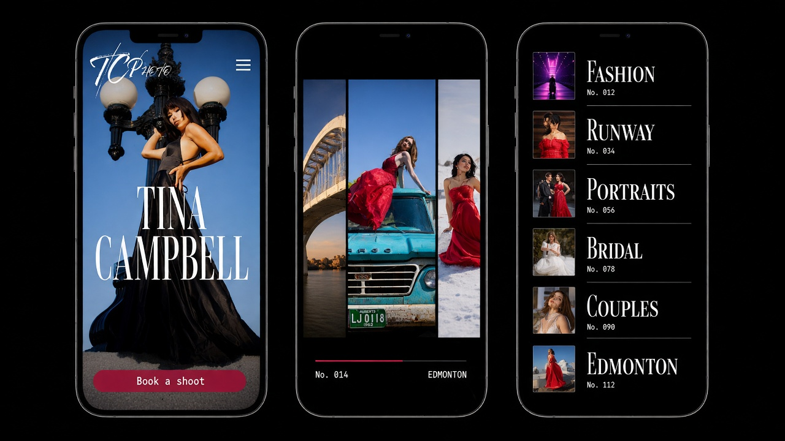

<p align="center"></p>

<h1 align="center">Tina Campbell · TCPhoto</h1>
<p align="center"><b>Edmonton, dressed up.</b><br>A motion-first portfolio for a fashion and portrait photographer, crafted by <b>KR8TIV</b>.</p>

---

## The brief, in one breath
Tina shoots gowns on rusty Fargo trucks, black satin on Legislature steps and runway looks under magenta light. Her old site made all of that sit politely in a grid. This one walks it down a catwalk.

## Directed by the client, literally
We showed Tina eight directions. She ticked five and wrote back:

> "I feel this captured my work in a nutshell. Layout is great. My fave is runway and editorial."

So that is the site. No sixth idea, no designer ego.

| She liked | It became |
|---|---|
| **Runway** (her favourite) | The whole system: photos glowing on ink black, crimson as the only button colour, a sideways catwalk of her best frames |
| **Editorial Split** (her other favourite) | Every page with words: photo on one side, real text on the other, like a magazine spread |
| **Bridge and Skyline** | The About page: Edmonton in three layers of parallax with her name tucked between them |
| **Film Strip** | Sprocket edges, frame numbers and the page transition that advances like film |
| **Noir and Crimson** | The Work grid: black and white until you hover, red always stays red |

Fashion leads (she loves it, and the site is built to get her paid for it). Portraits, headshots, bridal, couples and events live on their own Services page. Every comment and tick is traced in [FEEDBACK-MAP.md](FEEDBACK-MAP.md).

## Imagine first, code second
Every KR8TIV site starts as Grok Imagine layouts. We design the whole site as images, argue with them, regenerate anything that is not perfect, then build exactly what the pictures show.

| Page | Layout |
|---|---|
| Home | `concepts/site-layouts/01-home-desktop*.jpg` |
| Work index | `02-work-index-desktop*.jpg` |
| Fashion & Editorial | `03-fashion-editorial-desktop*.jpg` |
| Series story | `04-series-story-desktop*.jpg` |
| Portraits, Bridal and Couples | `05-portraits-bridal-desktop*.jpg` |
| Runway gallery | `06-runway-gallery-desktop*.jpg` |
| About | `07-about-desktop*.jpg` |
| Services | `08-services-desktop*.jpg` |
| Journal | `09-journal-desktop*.jpg` |
| Book a shoot | `10-contact-book-desktop.jpg` |
| Mobile: Home, Series, About | `11` to `13` |
| Motion moments: loader, transition, hover | `14` to `16` |

All of them on one page: [`concepts/site-layouts/sheet-site-layouts.jpg`](concepts/site-layouts/sheet-site-layouts.jpg). Motion previews (Imagine video) live in [`concepts/site-layouts/motion/`](concepts/site-layouts/motion/).

## Motion principles
1. **The photo is the hero.** Effects happen around her images, never baked into them. Full-res textures, no mush.
2. **Every move means something.** The catwalk scrolls sideways because runway. The grid starts in noir because her reds deserve the entrance.
3. **Weight, not wobble.** Lenis gives the scroll a little mass. Nothing bounces for fun.
4. **One crimson.** If it is red and it is not a dress, you can click it.
5. **Kind to every visitor.** Reduced motion gets calm fades, phones get swipe instead of hover, and nothing hides content if a script fails.

Full per-page choreography: [motion/MOTION-SPEC.md](motion/MOTION-SPEC.md). The award-level sites and tutorials we are borrowing from, with the exact move we steal from each: [motion/REFERENCES.md](motion/REFERENCES.md).

## Stack
| Layer | Tool | Job |
|---|---|---|
| Framework | **Astro** | Static pages, view transitions, image pipeline |
| Motion | **GSAP** + ScrollTrigger, Flip, SplitText, DrawSVG | Pins, scrubs, reveals, the signature that draws itself |
| Scroll | **Lenis** | Smooth scroll on the GSAP ticker |
| WebGL | **Three.js** | Curved catwalk planes, noir-to-colour hover, depth parallax |
| Tooling | **Node** | Build, sharp for AVIF/WebP, ffmpeg for loops |

## Staging
Preview: https://lightsteelblue-lark-427091.hostingersite.com/ (staging, not the final domain).

## Repo map
```
README.md              you are here
FEEDBACK-MAP.md        Tina's words -> pages, sections, motion
SPEC.md                full build spec and prompt plan
motion/
  REFERENCES.md        award sites + tutorials, verified links
  MOTION-SPEC.md       per-page motion, library by library
concepts/site-layouts/
  PROMPTS.md           every Imagine prompt, round 1 and the v2 fixes
  *.jpg                full-site layouts (desktop, mobile, motion moments)
  sheet-site-layouts.jpg   contact sheet
  motion/              Imagine motion previews + VIDEO-PROMPTS.md
```

## Status
Layouts and motion previews: in review with Matt. Code: next, built from the approved layouts. Nothing ships to Tina until Matt says go.

<p align="center"><sub>Crafted in Edmonton light by KR8TIV.</sub></p>
